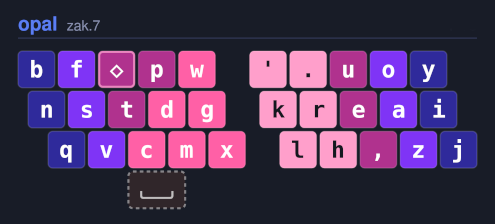
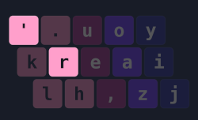
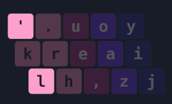

# QMK Adaptive Keys
A modern implementation of adaptive magic and adaptive swaps for QMK.

##### Adaptive Magic Key
Changes it's output depending on which key was pressed before it.

##### Adaptive Swap
After pressing an arbitrary leader key, temporarily swap the position of two keys.

For a more through overview, click [here](https://dario.ca/posts/2026-05-18-keyboard-layout-adaptive-swaps).

## Why?

Adaptive magic and adaptive swaps are concepts popularized by the [Alternate Keyboard Layouts](https://discord.gg/pjhz8QtjE2) discord.  
Layout authors use these to fix various issues with a keyboard layout.
  
&nbsp;  


This is [Opal's](opal) default keymap, with `◇` representing our adaptive magic key. Opal's keymap is very well optimized, but even so, there are issues we can address with adaptives.

## Adaptive Magic



Notice the position of apostrophe on the right hand. `'r` is a high occurrence bigram because of words like `you're`, and both letters are on the index finger. This is referred to as a [Same Finger Bigram](https://layouts.wiki/reference/metrics/same-finger/#same-finger-bigram) (SFB).

We can address this with the following adaptive magic rule:  
`After ', pressing the adaptive magic key emits r`  

And here is the equivalent implementation:
```
adaptive_keys.def

ON_ALL(KC_QUOT);
REPLACE(KC_ADAPTIVE_MAGIC, KC_R);
```

With this rule in place, instead of inputting `'r` we input `'◇`. `r` is now on a different finger than `'` until the next keypress, eliminating the SFB and improving the speed of our inputs.

## Adaptive Swap



Another high frequency SFB with apostrophe is `'l` with words like `you'll`. Again, both letters are on the index finger.

We can address this with the following adaptive swap rule:  
`After ', swap the positions of l and f`

Here is the equivalent implementation:
```
adaptive_keys.def

ON_ALL(KC_QUOT);
SWAP(KC_L, KC_F);
```

With this rule in place, instead of inputting `'l` we input `'f`.

We've now eliminated the majority of issues with the position of `'` on the right index. We can continue adding as many or as few rules as we'd like, but keeping in mind that the more rules we add the harder it will be to learn. 

If you'd just like to learn an existing layout, many of the most popular are in this repository.  

## Methods
`ON_ALL(INITIAL_KEY);`
On all layers, apply the following to `INITIAL_KEY`.

`ON(LAYER, INITIAL_KEY);`
On `LAYER` only, apply the following to `INITIAL_KEY`.

`SWAP(KEY1, KEY2);`
After pressing `INITIAL_KEY`, swap `KEY1` and `KEY2`.

`REPLACE(KEY1, KEY2);`
After pressing `INITIAL_KEY`, replace `KEY1` with `KEY2`.

Note: A character **must only appear once** as `INITIAL_KEY`.

## Usage

1. Copy `adaptive_keys.h` and the `example` folder to your keyboard's keymap directory.
For example: `qmk_firmware/keyboards/<keyboard brand>/<keyboard name>/<keyboard version>/keymaps`

2. Create a keymap using QMK's [Configurator](https://config.qmk.fm).

3. If you'd like to include an adaptive magic key, apply the ANY function to a key.  
Paste `KC_ADAPTIVE_MAGIC` into the ANY key's text field. 

5. Download `keymap.json` to the `example` folder we copied.
  
6. Convert the keymap to code.  
`qmk json2c keymap.json >> keymap.c`  
This adds the keymap to our existing `keymap.c`.

7. Add any adaptive magic to `adaptive_keys.def`.

8. Flash your firmware.  
`qmk flash -kb <your keyboard> -km example`

For a complete example, refer to the Opal directory.  

## FAQ

**What happens if you press an adaptive magic key without any rules active?**  
By default the adaptive magic key functions as a [repeat key](https://docs.qmk.fm/features/repeat_key).

**How do I change the default output of the adaptive magic key?**  
Add the following to `keymap.c`:  
```
void keyboard_post_init_user(void) {
  set_adaptive_magic_default(<KC_KEY>);
}
```

**How do I add a second adaptive magic key?**  
At this time, only a single adaptive magic key is supported.

**How do I add combos?**  
[Combos](https://docs.qmk.fm/features/combo) are already built-in to QMK.

**Which layout should I learn?**  
If you'd like to learn more about Alternate Keyboard Layouts, join us in our [discord](https://discord.gg/pjhz8QtjE2). We are always happy to help.
